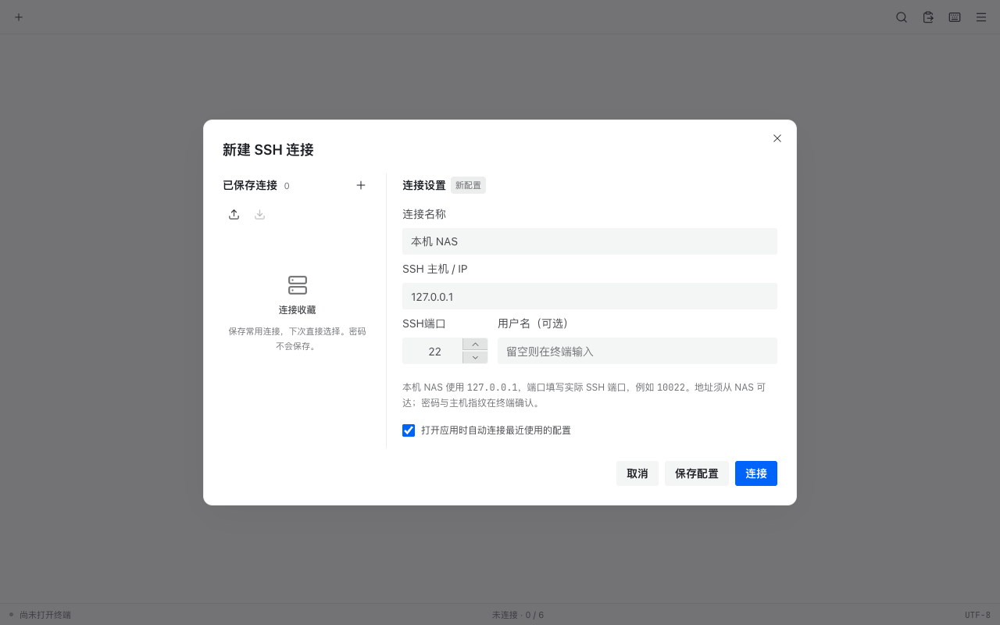
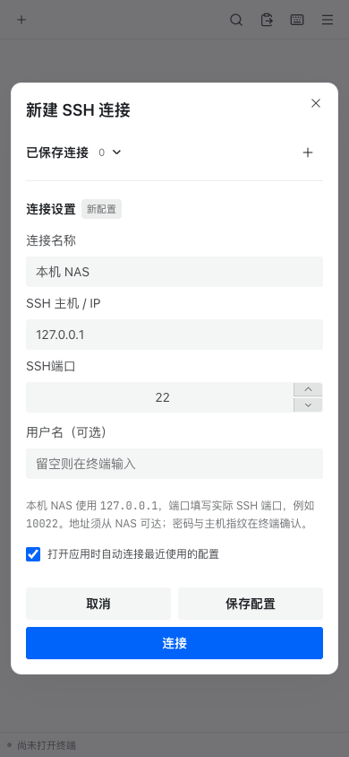

# FnTerminal


飞牛 fnOS 原生终端应用，通过应用中心手动安装 FPK。使用统一网关接入 NAS 管理员登录态，通过 WebSocket + PTY 提供交互式终端，再经 SSH 登录目标账户。服务以独立应用账户运行，默认不获取 root 权限。

**当前版本：0.9.0 预发布。** 本机自动化、隔离 Linux SSH/PTY 与双架构打包检查已通过；真实 fnOS 安装、升级、卸载和权限验收仍待验证。详见 [测试结果](docs/TEST_RESULTS.md) 和 [验收步骤](docs/FNOS_TEST_PLAN.md)。

## 下载与安装

从 [v0.9.0 Release](https://github.com/BeeThor/FnTerminal/releases/tag/v0.9.0) 下载：

| 设备 | 安装包 |
| --- | --- |
| Intel / AMD，x86_64 | [FnTerminal-0.9.0-x86.fpk](https://github.com/BeeThor/FnTerminal/releases/download/v0.9.0/FnTerminal-0.9.0-x86.fpk) |
| ARM64 | [FnTerminal-0.9.0-arm.fpk](https://github.com/BeeThor/FnTerminal/releases/download/v0.9.0/FnTerminal-0.9.0-arm.fpk) |

1. 使用 Release 中的 `SHA256SUMS` 核对下载文件。
2. 在 fnOS **应用中心 → 设置 → 手动安装应用** 上传对应 FPK，启用应用。
3. 使用已登录的 fnOS 管理员账户打开 FnTerminal。首次进入填写 SSH 连接：本机地址为 `127.0.0.1`，端口填写实际 SSH 端口，例如 **10022**；填写 NAS 用户名。
4. 点击连接，在终端确认主机指纹并输入密码。应用不会自动开启 SSH，也不保存密码。
5. 点击标签栏 **＋** 新建连接；从终端菜单编辑当前连接。已保存配置可搜索、修改、删除及导入导出，下次打开可自动连接最近使用的配置。

若应用启动失败，检查 `/var/apps/fnterminal/var/fnterminal.log`；连接问题可查看菜单中的“连接诊断与日志”。[只读诊断脚本](scripts/diagnose-fnos.sh) 和 [详细安装说明](docs/DEVELOPMENT.md#安装) 提供进一步排查步骤。

## 功能

- 多标签终端、搜索、重连、重命名、排序、锁定及终端内容导出。
- 可编辑的 SSH 连接管理，支持自定义端口、IPv4 / IPv6 / 域名及数字开头用户名。
- 复制粘贴、中文输入、移动快捷键、浅深色界面和独立终端配色。
- 响应式弹窗、固定操作区、长文本换行与溢出处理。
- 会话并发、输入输出限流、空闲和寿命超时、登录态续期及终端进程回收。
- 全部前端资源随包离线提供，无外部 CDN 或额外终端 TCP 端口。

终端界面实际提取并适配自 [ys-ll/uniterm](https://github.com/ys-ll/uniterm) 的开源 Vue 组件，原始源码、许可证和改动记录保留在 `third_party/uniterm/`。控件使用 Element Plus，并采用官方 Semi 主题变量匹配飞牛公开界面的视觉规范；完整 fnOS 桌面组件库及主题匹配仍待真机确认。[上游来源](docs/UPSTREAM.md) · [UI 核对](docs/FNOS_UI_REVIEW.md)



<details>
<summary>手机布局预览</summary>



</details>

以上为本机浏览器测试截图，未冒充 fnOS 实机界面。

## 权限与验证范围

应用服务和诊断 Shell 以 `fnterminal` 独立账户运行。日常 NAS 操作经 SSH 二次认证，权限由 SSH 目标账户控制。诊断 Shell 仅供应用排查；不同管理员共享应用账户的 HOME，它不是容器隔离环境。

生产服务只监听 Unix Socket，校验 `SO_PEERCRED` 可信网关对端及管理员 Header；Socket 默认 0600、仅信任 UID 0。**真实 fnOS 网关 UID、ACL 和注销行为仍待核验。** 如需配置实际网关身份，按 [登录态与权限说明](docs/DEVELOPMENT.md#登录态与权限) 操作；不得通过放宽为 666/777 或 root 运行解决鉴权问题。

已通过 Go race/vet/module 校验、36 项前端单元测试、42 项浏览器检查和 28 项布局场景；隔离 ARM64 Linux 验证了真实 UDS 网关、SSH 22/10022 端口、数字用户名及进程回收。真实 fnOS、ARM NAS 和手机输入法/剪贴板仍待验证。[版本验证记录](docs/validation/0.9.0.json)

## 开发与构建

需要 Go 1.22+、符合 Vite 要求的 Node.js（20.19+ / 22.12+）及 Python 3 + Pillow；NAS 运行时无需这些构建工具。

```bash
python3 -m pip install -r requirements-build.txt
npm ci --ignore-scripts --no-audit --no-fund
./scripts/download-fnpack.sh
./scripts/check.sh
./scripts/build-fpk.sh x86
./scripts/build-fpk.sh arm
python3 scripts/package-source.py
```

产物写入 `dist/`。FPK 使用飞牛官方 fnpack，包含架构、资源、执行权限、图标和校验和检查。完整发布回归见 [开发说明](docs/DEVELOPMENT.md#源码与构建)；GitHub Actions 自动执行检查并构建双架构 FPK。

```text
cmd/fnterminal/        Go 服务、鉴权、PTY 和会话管理
frontend/             Vue 终端界面与连接管理
packaging/            fnOS manifest、权限、入口和生命周期脚本
scripts/              构建、打包、诊断与验证工具
tests/                前端、浏览器及布局回归
docs/                 安装验收、架构、上游与验证记录
third_party/uniterm/  上游原始文件、许可与来源校验
```

源码仓库不包含依赖、缓存、原始测试日志及二进制；最终 FPK、源码 ZIP、校验和与验证报告发布在 Releases。

## 开源许可

FnTerminal 自有代码采用 [MIT](LICENSE)。提取自 Uniterm 的文件继续遵守 [Apache-2.0](third_party/uniterm/LICENSE)，字体与其它依赖遵守各自许可。详见 [NOTICE](NOTICE) 和 [上游声明](third_party/uniterm/THIRD_PARTY_NOTICES.md)。FnTerminal 是独立项目。

[贡献指南](CONTRIBUTING.md) · [安全问题](SECURITY.md) · [变更记录](CHANGELOG.md)
